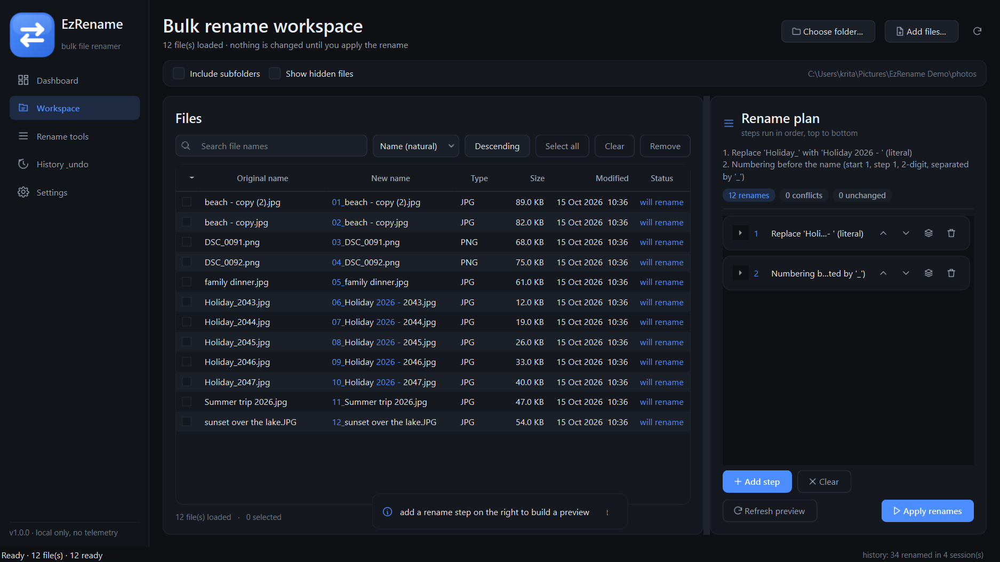
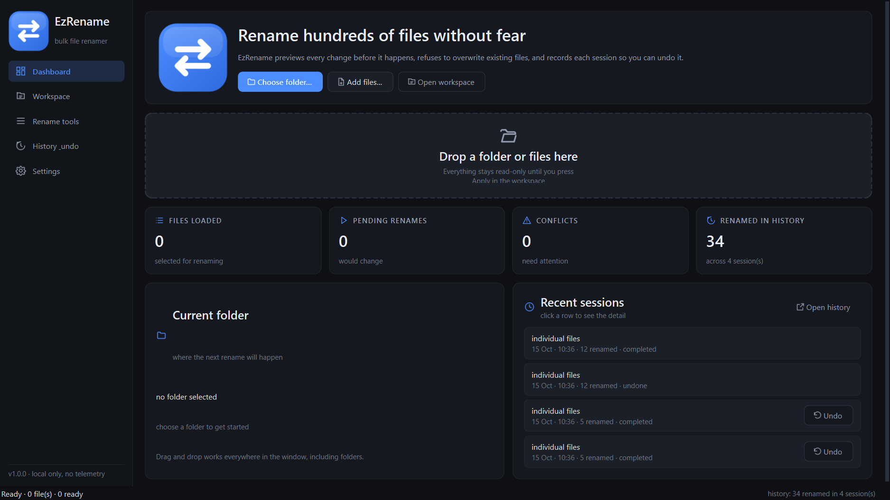
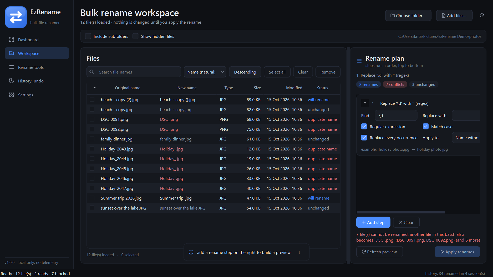
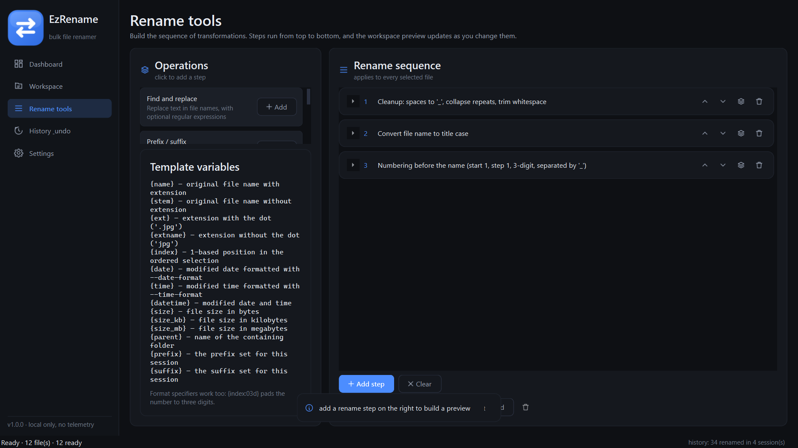
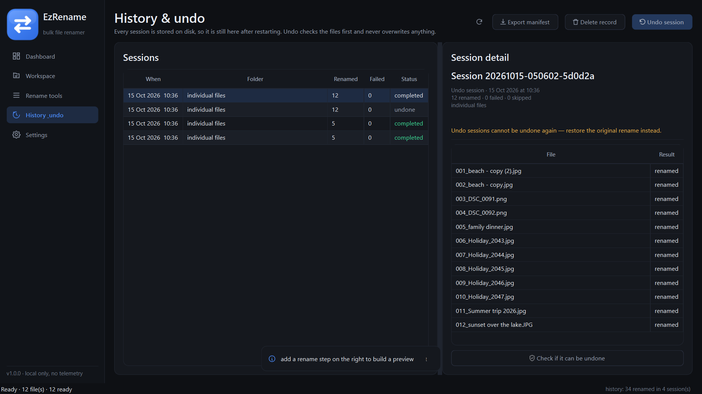
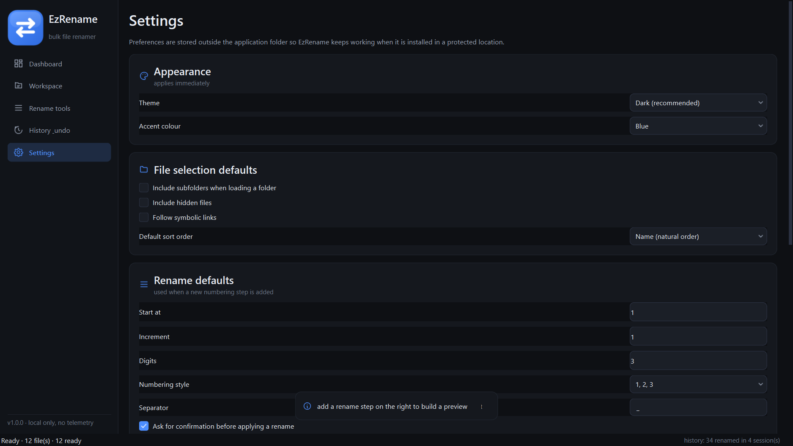
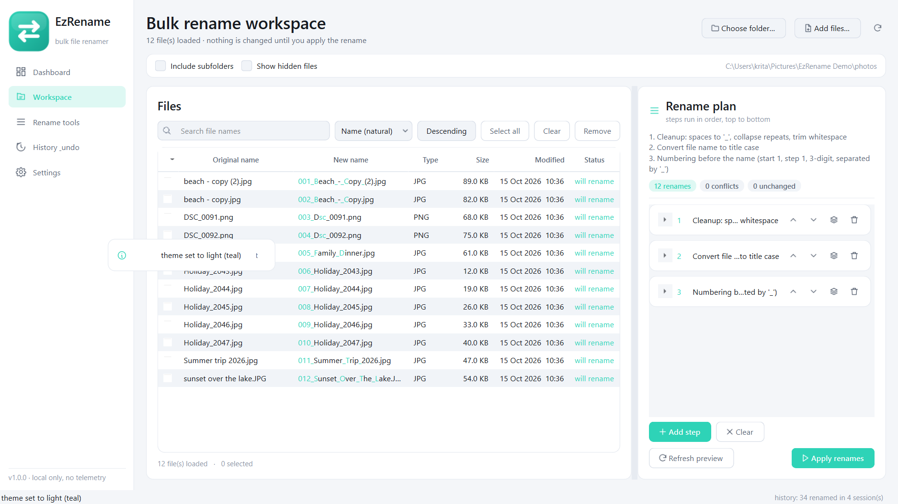

<div align="center">


# EzRename

**A safe, previewable bulk file renamer for Windows — polished desktop app and a first-class CLI.**

[](LICENSE)
[](https://www.python.org/downloads/)
[](requirements.txt)
[](#running-the-tests)
[](#requirements)
[](CHANGELOG.md)
[](https://github.com/kritagyadubey/EzRename/releases/latest)

[](https://github.com/kritagyadubey/EzRename/stargazers)
[](https://github.com/kritagyadubey/EzRename/issues)

</div>

---

EzRename renames hundreds or thousands of files at once without the usual fear:
every change is previewed first, nothing on disk is touched until you apply it,
existing files are never silently overwritten, and each session is recorded so
it can be undone later.

The graphical application and the command line tool share one renaming engine,
so a preview in the app and a `--dry-run` in the terminal always agree.

## Table of contents

- [What it looks like](#what-it-looks-like)
- [Features](#features)
- [Installation](#installation)
- [Using the GUI](#using-the-gui)
- [Using the CLI](#using-the-cli)
- [Renaming operations](#renaming-operations)
- [Safety model: dry runs, collisions, history and undo](#safety-model-dry-runs-collisions-history-and-undo)
- [Building from source](#building-from-source)
- [Running the tests](#running-the-tests)
- [Project structure](#project-structure)
- [Dependencies](#dependencies)
- [Known limitations](#known-limitations)
- [License](#license)

## What it looks like

Every screenshot below is a capture of the running application, produced by
[`tools/make_screenshots.py`](tools/make_screenshots.py).

### Workspace — original and proposed names side by side



Changed characters are highlighted inside the proposed name, conflicts are red,
and the rename sequence sits on the right with the apply button disabled while
anything is blocked.

### Dashboard, conflicts, tools, history and settings

| Dashboard | Conflicts are blocked, not guessed |
|---|---|
|  |  |

| Rename tools | History & undo |
|---|---|
|  |  |

| Settings | Light theme |
|---|---|
|  |  |

A documents workflow showing space normalisation, lower-cased extensions and a
date prefix applied in one pass: [08-documents.png](assets/screenshots/08-documents.png).
All eight screenshots are also browsable in [`docs/gallery.html`](docs/gallery.html).

## Features

**Two complete interfaces, one engine**

- `EzRename.exe` — a dark, high-DPI aware desktop application (Dashboard,
  Workspace, Rename tools, History & undo, Settings).
- `ezrename-cli.exe` — a scriptable command line tool with stable exit codes,
  JSON output and no GUI dependency at all.

**Renaming toolkit** — find & replace (literal or regex), prefix/suffix add and
remove, sequential numbering (decimal, letters, roman, any start/step/padding),
case conversion, separator and whitespace cleanup, duplicate word removal,
extension change/re-case/removal, filesystem date insertion, file-specific
templates and text insertion/removal. Steps are combined into an ordered
sequence that both interfaces understand.

**Preview first** — the workspace shows the original name, the proposed name,
which characters change, per-file status, duplicate targets, destination
conflicts, invalid names and the reason any file is skipped. The preview never
touches the filesystem.

**Safety** — no deletion, no silent overwrite, two-phase renames for swaps and
cycles, per-file rollback plus whole-batch rollback when a swap cannot be
completed, quarantine backups when you explicitly allow replacing a file, and
honest reporting of the real state of every file afterwards.

**History & undo** — every session is stored in a small SQLite database next to
your settings, survives restarts, can be re-verified against the current
filesystem, restored, or exported as a JSON/CSV manifest for auditing.

**Files and folders** — native folder picker, add individual files, drag and
drop anywhere in the window, optional subfolder scanning, hidden file support,
extension/glob/size/text filters, search box, sorting (including natural
`img2` before `img10`), reordering for numbering, selection helpers and a
"remove from list" action that never deletes anything.

## Installation

### Windows executables (no Python needed)

1. Download the archive for the interface you need from the
   [latest release](https://github.com/kritagyadubey/EzRename/releases/latest):
   `EzRename-1.0.0-win64-gui.zip` (desktop app) and/or
   `EzRename-1.0.0-win64-cli.zip` (terminal tool).
2. Extract the whole folder anywhere — no administrator rights needed.
3. Run it:
   - **GUI:** double-click `EzRename\EzRename.exe`
   - **CLI:** open a terminal in the folder and run `ezrename-cli.exe --help`

Each archive contains a single top-level folder with its own `README.txt` and
the `LICENSE`, and the release notes list SHA-256 checksums for verification.

Prefer to build it yourself? `python tools/build.py` produces the same two
folders under `dist\` (see [Building from source](#building-from-source)).

Both executables work from a normal extracted folder, need no administrator
rights for renaming, and store settings and history in your own user profile
(`%APPDATA%\EzRename` and `%LOCALAPPDATA%\EzRename`), never next to the
executable.

### From source

```bash
git clone https://github.com/kritagyadubey/EzRename.git
cd EzRename
python -m venv .venv
.venv\Scripts\activate            # or: source .venv/bin/activate
python -m pip install -r requirements-dev.txt
```

Launch the application or the CLI without installing anything:

```bash
python -m ezrename                 # graphical interface
python -m ezrename.cli.main --help # command line interface
```

Or install it as a command:

```bash
python -m pip install -e .
ezrename --help
ezrename-gui
```

## Using the GUI

1. **Choose a folder** (or drag one onto the window). The workspace loads the
   files — nothing is modified yet.
2. **Add rename steps** on the right of the workspace or on the *Rename tools*
   page: each step is a small editor with a live example, and steps can be
   reordered, duplicated, disabled by clearing and saved as presets.
3. **Read the preview.** The table shows *original name → new name* with changed
   characters highlighted, plus type, size, modified date and status. Conflicts
   are listed under the plan and the apply button is disabled while they exist.
4. **Apply.** A progress panel with a working cancel button appears if the list
   is large; a detailed report follows, with buttons to undo the session or
   export its manifest.
5. **Undo from History** whenever the files are still where the rename left them.

Keyboard shortcuts: `Ctrl+O` choose folder · `Ctrl+Shift+O` add files ·
`Ctrl+R`/`F5` refresh · `Ctrl+F` search · `Ctrl+A` select all · `Delete` remove
rows · `Ctrl+Enter` apply · `Ctrl+Z` undo last session · `Ctrl+1…5` switch pages.

## Using the CLI

```
ezrename list    PATH                 list the files a command would work on
ezrename preview PATH [operations]    show the plan, change nothing
ezrename rename  PATH [operations]    apply a rename
ezrename undo    [SESSION|--last]     restore a previous session
ezrename history [--session ID]       browse stored sessions
ezrename export  SESSION --output F   write a JSON/CSV manifest
ezrename ops                          list operations and template variables
ezrename config  [--show|--path]      show where settings and history live
ezrename gui     [PATH]               open the desktop application
```

Examples:

```bash
# See what would happen before touching anything
ezrename preview ./photos --prefix "Vacation_"
ezrename rename ./photos --replace-spaces "_" --dry-run

# Find and replace, then apply
ezrename rename ./photos --find "IMG_" --replace "Photo_" --yes

# Sequential numbering with padding, in name order
ezrename rename ./photos --number --start 1 --padding 3 --number-position prefix --yes

# Case conversion, recursive, only JPEG/PNG files
ezrename rename ./photos --recursive --ext jpg,png --case lower --dry-run

# Dates, templates and combined steps
ezrename rename ./scans --insert-date --date-format "%Y-%m-%d" --yes
ezrename rename ./music --template "{index:02d} - {stem}{ext}" --yes
ezrename rename ./photos --find "IMG" --replace "Photo" --replace-spaces "_" --case lower --yes

# Conflicts are reported and blocked, exit code 3
ezrename rename ./photos --find "1" --replace "2" ; echo $?

# Records, recovery and automation
ezrename history --limit 10
ezrename undo --last --dry-run
ezrename undo 20261015-101500-ab12cd --allow-partial --yes
ezrename export 20261015-101500-ab12cd --output manifest.json
ezrename rename ./photos --case upper --dry-run --json | jq '.summary'
```

`rename` uses the same validation, collision detection and safety rules as the
preview. It asks for confirmation before applying unless you pass `--yes`
(required when the output is not a terminal, so scripts never hang waiting for
input; `EZRENAME_ASSUME_YES=1` works too).

**Exit codes**

| Code | Meaning |
|-----:|---------|
| `0` | success — every planned rename succeeded |
| `1` | at least one file failed and could not be rolled back |
| `2` | usage error (unknown option, missing folder, not confirmed) |
| `3` | blocked by conflicts, duplicate targets or invalid names — nothing changed |
| `4` | nothing to do — no files matched or nothing would change |

More detail, including every option and the JSON shapes:
[docs/CLI.md](docs/CLI.md).

## Renaming operations

| Operation | What it does |
|---|---|
| **Find and replace** | Literal or regular expression, case sensitive or not, all or first occurrence, on the name, the extension, both or the full name. |
| **Prefix / suffix** | Add or strip a prefix or suffix, before or after the extension. |
| **Sequential numbering** | Start, step, zero padding, separator, placement (before/after/replace) and styles: `1,2,3` · `a,b,c` · `A,B,C` · `i,ii,iii` · `I,II,III`. |
| **Case** | UPPER, lower, Title or Sentence case on the name, the extension or both. |
| **Separators & cleanup** | Spaces to `_`/`-`/custom, collapse repeated separators, remove duplicate words, trim whitespace, strip characters, character replacement. |
| **Extension** | Set a new extension, lower/upper case it, remove it, or act only on chosen extensions — with a note that no format conversion happens. |
| **Date & time** | Insert the modified, created or accessed timestamp with any `strftime` pattern, before or after the name. |
| **Template** | Build names from `{name}` `{stem}` `{ext}` `{extname}` `{index}` `{date}` `{time}` `{datetime}` `{size}` `{size_kb}` `{size_mb}` `{parent}` `{prefix}` `{suffix}`, with format specifiers such as `{index:03d}`. |
| **Insert / remove text** | Insert text at a fixed position, or remove text from the start, the end, everywhere or the first/last occurrences. |

Steps run top to bottom. The CLI combines its flags in one documented order
(find/replace → insert/remove text → cleanup → case → date → prefix/suffix →
template → numbering → extension) and can also take the exact sequence from a
JSON file with `--config ops.json`.

## Safety model: dry runs, collisions, history and undo

**Dry runs.** `--dry-run` (CLI), the preview table (GUI) and `preview` all
compute names without touching the filesystem. In a dry run the executor
returns `planned` entries and reports zero renamed files.

**Collisions are blocked, never guessed.** Before anything is renamed EzRename
checks that no two files would end up with the same name (case-insensitively on
Windows), that no target is already taken by a file outside the batch, and that
every result is a legal Windows name — no reserved device names (`CON`, `NUL`,
`LPT1`…), no illegal characters, no trailing dot or space, not empty and within
the length limit.

**Two-phase renames.** Renames that would collide with each other (a swap such
as `a.txt ⇄ b.txt`, a longer cycle, or a case-only change on a case-insensitive
filesystem) are performed through unique intermediate names first, then to their
final names. No file is ever moved to a name that is still occupied.

**Rollback, per file and per batch.** If a rename fails (file locked by another
program, read-only, permission denied), that file is put back under its original
name and the failure is reported with the real reason. If a swap cannot be
completed safely, the *whole batch* is rolled back so the folder returns to the
state it had before, and any file that could not be restored is listed with the
name it is currently stored under.

**No deletion, ever.** EzRename only renames. If you explicitly ask to replace
an existing destination (`--overwrite` in the CLI, confirming the warning in the
GUI), the existing file is moved to a `.ezrename-backup.<token>-<name>` file
next to it and reported in the result — nothing is destroyed, and "undo"
restores it too. A dry run cannot be combined with overwriting; the default is
to refuse.

**Symlinks, hidden files and temp files.** Symbolic links are skipped unless you
opt in, hidden files are opt-in, and EzRename's own intermediate files are
ignored by every scan so an interrupted session can never be re-processed.

**History and undo.** Each executed session is written to
`%LOCALAPPDATA%\EzRename\history.db` with every original path, resulting path,
status, timestamp and the operations used. Undo re-verifies the current state
first: a file that has been moved, deleted or replaced blocks the undo and
EzRename explains why instead of pretending to restore it. A session can be
restored completely, partially (only the files that are still safe, with
`--allow-partial`) or not at all, and every attempt is itself recorded.

Details and the exact rules: [docs/SAFETY.md](docs/SAFETY.md).

## Building from source

```bash
python -m pip install -r requirements-dev.txt
python tools/build.py             # build both executables and smoke-test them
python tools/build.py --only-test # test an existing build
```

The build uses [`packaging/ezrename.spec`](packaging/ezrename.spec) and produces
an onedir bundle per executable:

```
dist/
├── EzRename/
│   ├── EzRename.exe          # graphical application (no console window)
│   └── _internal/…           # Qt runtime and plugins
└── ezrename-cli/
    ├── ezrename-cli.exe      # command line tool (console)
    └── _internal/…
```

`tools/build.py` then runs the packaged binaries against disposable folders and
prints the real exit codes: version/help output, listing, JSON preview, dry run,
an actual rename, history, undo, invalid-argument handling and a GUI launch that
must stay alive. The build regenerates the icon
(`tools/make_icons.py`) and embeds `packaging/version_info.txt`, so file
properties in Explorer show the real product name and version.

Build/run details, including how to ship a release folder:
[docs/BUILD.md](docs/BUILD.md).

## Running the tests

```bash
python -m pytest            # all tests
python -m pytest tests/test_engine.py -v
```

Current status on Windows 11 with Python 3.14.7: **260 passed, 1 skipped**.

| Suite | Covers |
|---|---|
| [`tests/test_operations.py`](tests/test_operations.py) | Every operation, validation, name composition, templates, numbering styles |
| [`tests/test_pipeline.py`](tests/test_pipeline.py) | Plan building, duplicate/existing/invalid detection, unicode, multi-dot names, hidden and temp files |
| [`tests/test_engine.py`](tests/test_engine.py) | Dry runs, swaps, cycles, overwrite quarantine, per-file rollback, batch rollback, cancellation, progress |
| [`tests/test_history.py`](tests/test_history.py) | Session persistence across restarts, verification, undo (full, partial, refused), export, pruning |
| [`tests/test_discovery.py`](tests/test_discovery.py) | Folder scanning, recursion, filters, sorting, settings storage |
| [`tests/test_cli.py`](tests/test_cli.py) | Every command, exit codes, JSON output, spaces/unicode paths, confirmation rules, config files |
| [`tests/test_gui.py`](tests/test_gui.py) | The real window offscreen: navigation, live preview, applying, undoing, presets, settings, shortcuts |

The one skipped test creates a symlink, which needs either developer mode or
elevation; it runs automatically where that is available.

## Project structure

```
EzRename/
├── src/ezrename/
│   ├── core/                 # platform-aware engine, no GUI dependency
│   │   ├── naming.py         # Windows filename rules, case handling, temp names
│   │   ├── operations.py     # the rename operations (serialisable)
│   │   ├── pipeline.py       # operations + files -> validated plan
│   │   ├── engine.py         # safe executor (two-phase, rollback, dry run)
│   │   ├── discovery.py      # scanning, filtering, sorting
│   │   ├── history.py        # SQLite history, verification, undo, export
│   │   └── settings.py       # user settings in a writable location
│   ├── cli/                  # argparse interface + terminal rendering
│   └── gui/                  # PySide6 application
│       ├── theme.py          # design tokens and stylesheet
│       ├── icons.py          # vector icons rendered at runtime
│       ├── widgets.py        # cards, badges, drop area, toasts, progress
│       ├── filetable.py      # file list with highlighted name diff
│       ├── opeditor.py       # editors generated from the operation dataclasses
│       ├── pages/            # dashboard, workspace, tools, history, settings
│       ├── dialogs.py        # report, undo assistant, about
│       └── workers.py        # background threads for scanning/renaming/undo
├── assets/                   # icon, logo, screenshots
├── docs/                     # CLI reference, safety model, architecture, build, gallery
├── packaging/                # PyInstaller spec and Windows version resource
├── tests/                    # pytest suite
└── tools/                    # build, icon and screenshot scripts
```

## Dependencies

| Requirement | Why |
|---|---|
| Python ≥ 3.9 | runtime |
| [PySide6](https://pypi.org/project/PySide6/) ≥ 6.6 | the graphical interface (Qt widgets, SVG icons) |

Everything else — the engine, the SQLite history, the CLI, the installers — uses
the Python standard library only, so `ezrename-cli` runs on a bare Python
install. Development additionally needs `pytest` and `pyinstaller`
([requirements-dev.txt](requirements-dev.txt)).

## Known limitations

- **Windows is the supported target.** The engine is platform-aware (separators,
  case sensitivity, reserved names, hidden attributes) and the CLI runs fine on
  Linux and macOS, but the packaged executables and the tested paths are Windows.
- **Renames stay inside the folder.** EzRename renames files where they are; it
  never moves them between folders. Templates expose `{parent}` but not paths.
- **Extension changes rename only.** Changing `.jpg` to `.png` never converts the
  file's contents, and the app says so when the operation is used.
- **Undo needs the files to still be there.** If a file was moved, deleted or
  replaced after the rename, that file cannot be restored; the rest still can.
- **Locked files fail per file.** A file held open by another program cannot be
  renamed by any tool; EzRename reports it and rolls the entry back.
- **One session at a time.** A second EzRename instance shares the same history
  database, but concurrent runs in the same folder can still race with each
  other like any two programs would.
- **Screen-reader support is basic.** Keyboard navigation, focus order and
  tooltips are in place, but the custom-painted cells are not described to
  assistive technology as thoroughly as native controls would be.

## License

[MIT](LICENSE) © 2026 Kritagya Dubey and EzRename contributors.

## Changelog

See [CHANGELOG.md](CHANGELOG.md).
